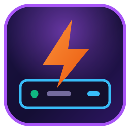
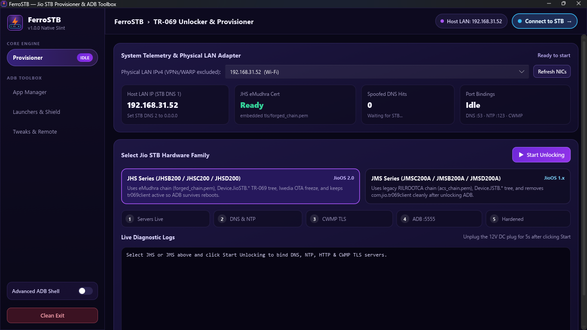
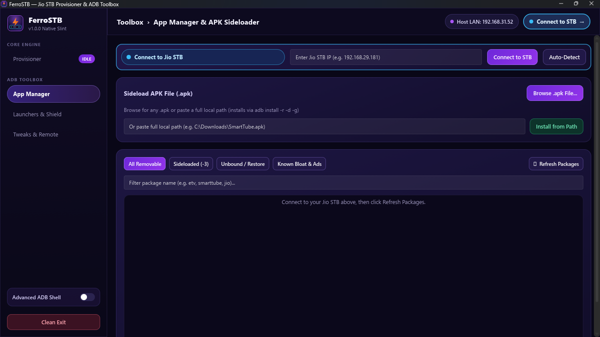
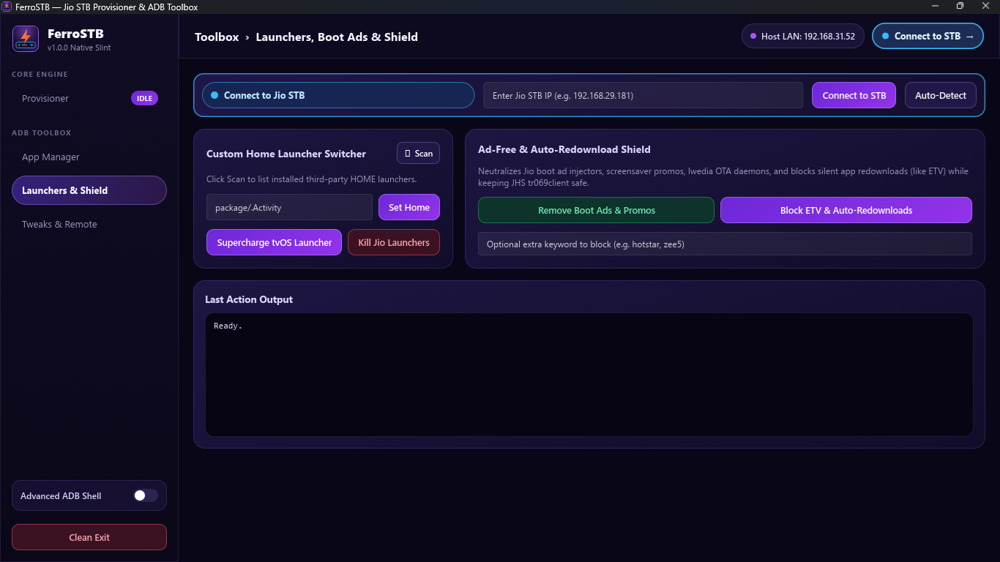
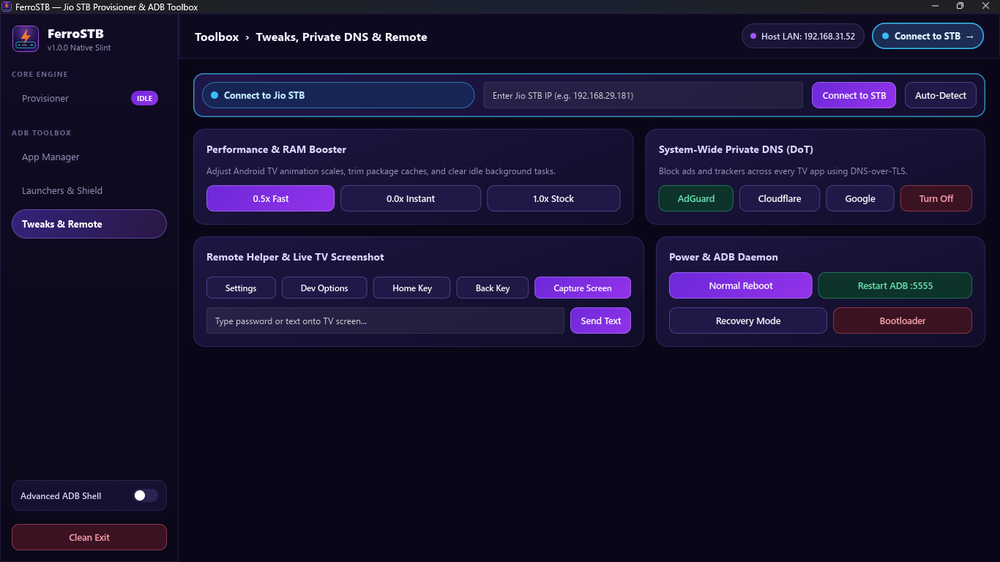
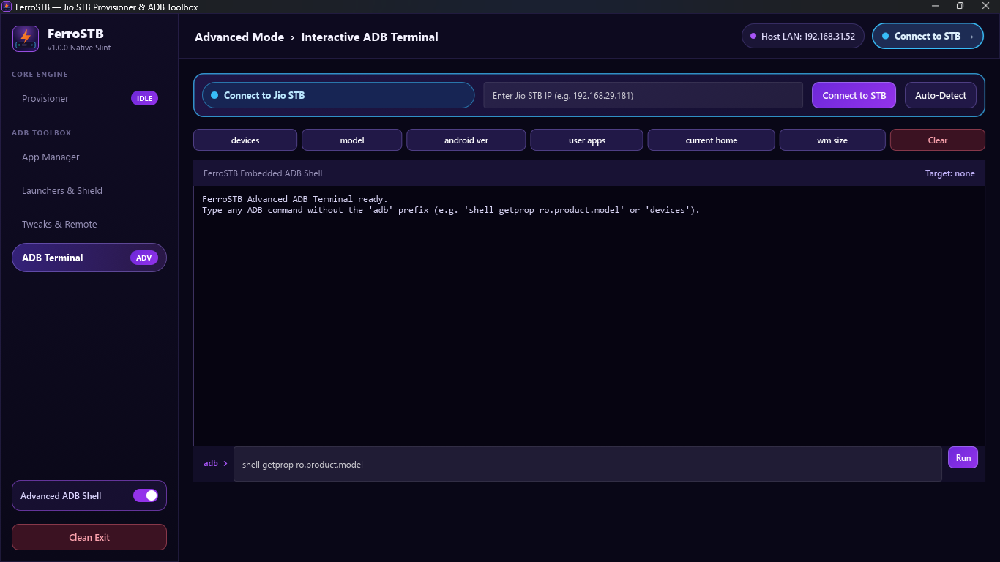

# FerroSTB

*Tired of unskippable startup ads, locked home screens, and blocked app installs on your Jio Set-Top Box?
FerroSTB is a free, lightweight native Windows and Linux desktop app that unlocks your Jio STB in under 3 minutes—no coding, no Docker, no WebView2, and no complicated setup required. Run one executable on your PC, restart your box, and get a clean, fast Android TV home screen where you can sideload any APK and delete unwanted bloatware.*

**Single-Binary Native Slint & Rust TR-069 Provisioner, Ad-Blocker & Visual ADB Toolbox for Jio Set-Top Boxes**

  
  
  
  
  
  
  

---

## Screenshots

### 1. TR-069 Unlocker & Live 5-Stage Provisioner

  

<table>
  <tr>
    <td align="center" width="50%">
      <strong>2. App Manager &amp; APK Sideloader</strong>  
      
    </td>
    <td align="center" width="50%">
      <strong>3. Launchers, Boot Ads &amp; Shield</strong>  
      
    </td>
  </tr>
  <tr>
    <td align="center" width="50%">
      <strong>4. Tweaks, Private DNS &amp; Remote</strong>  
      
    </td>
    <td align="center" width="50%">
      <strong>5. Advanced Mode: ADB Shell</strong>  
      
    </td>
  </tr>
</table>

---

## Overview

**FerroSTB** is a standalone, single-binary Rust desktop suite (`ferrostb.exe` on Windows, `ferrostb` on Linux) featuring a native **Slint** interface with zero browser or WebView2 dependencies. It unifies the entire network spoofing stack, TR-069 CWMP TLS server, live 5-stage diagnostic pipeline, visual post-unlock ADB Toolbox, and an interactive ADB terminal into a single executable with all runtime APKs, TLS chains, and platform ADB binaries embedded directly in memory.

> [!NOTE]
> **Supported Hardware & Firmware:**
> * **JHS Series (`JHSB200` / `JHSC200` / `JHSD200` — JioOS 2.0):** Uses the bundled eMudhra certificate chain (`forged_chain.pem`), traverses the `Device.JioSTB.*` TR-069 tree, freezes Iwedia OTA services, and preserves `com.jio.tr069client` so wireless ADB (`:5555`) survives reboots.
> * **JMS Series (`JMSC200Av2` / `JMSB200A` / `JMSD200A` — JioOS 1.x):** Uses the embedded `RILROOTCA` chain (`acs_chain.pem`), traverses `Device.JSTB.*`, and strips `com.jio.tr069client` cleanly after unlocking ADB.

> [!TIP]
> **Recovery & Troubleshooting:**
> * **Accidentally removed a system component?** Open **App Manager → Unbound / Restore** and click **Restore** next to any unbound or disabled firmware package to re-bind it without resetting the box.
> * **Provisioning stalled?** Check the live 5-stage pipeline and diagnostic banner in the **Provisioner** view for pinpointed error detection and recovery steps.
> * **Device misbehaving?** Perform a factory reset on your Jio STB to restore clean firmware defaults.
> * **Wi-Fi connection stalled?** Open network settings on the STB, select **Forget Network**, and reconnect.

> [!IMPORTANT]
> **On-Device APK Installer Restriction:**
> Jio firmware disables the stock Android package installer UI on the Set-Top Box, preventing direct APK installation from on-device file managers. Use **App Manager → Browse .apk File...** (or paste a local path) inside FerroSTB on Windows or Linux to install `.apk` files over wireless ADB.

---

## Release Bundles

Pre-compiled single-binary releases are published automatically to the **[Releases](https://github.com/eadxmz/FerroSTB/releases)** page on every update:

  
  

| Release Archive | Target OS | Included Binary |
| :--- | :--- | :--- |
| **`FerroSTB-Windows-v1.0.0.zip`** | Windows 10 / 11 (`x86_64-pc-windows-msvc`) | `ferrostb.exe` |
| **`FerroSTB-Linux-v1.0.0.zip`** / **`.tar.gz`** | Linux (`x86_64-unknown-linux-gnu`) | `ferrostb` |

---

## Core Provisioning Capabilities (`Provisioner` Tab)

* **VPN-Safe Physical LAN IPv4 Detection:** Automatically excludes Cloudflare WARP (`172.16.0.2` / `100.64.0.0/10`), Tailscale, WireGuard, OpenVPN, WSL, Docker, and Hyper-V virtual interfaces, ranking your physical Ethernet/Wi-Fi adapter first with an interactive NIC selector dropdown.
* **Dual Hardware Family Engine (JHS & JMS):** One-click switching between **JHS** (eMudhra `forged_chain.pem` — bundled in-binary with optional external `forged_chain.pem` override) and **JMS** (`RILROOTCA` `acs_chain.pem`).
* **Wireless ADB Unlock:** Enables network ADB on TCP port `5555` with extended debug validity through `2037`.
* **tvOS Launcher Installation & Permission Granting:** Sideloads **tvOS Launcher** (`com.techgenius.tvoslauncher`) and automatically configures `WRITE_SECURE_SETTINGS`, `PACKAGE_USAGE_STATS`, Location access, Notification Listener (`MediaWatchService`), Accessibility (`PowerService`), Device Admin (`SleepReceiver$Admin`), and battery optimization whitelist.
* **Permanent Home Button Lock:** Force-stops, suspends, disables, and unbinds `com.jio.stb.screens`, `com.iwedia.ui.rjio.launcher.reliance`, and any dynamic Jio/Iwedia `CATEGORY_HOME` resolvers so the remote **Home** button never reverts to the stock interface.
* **Shevery Privileged Service:** Sideloads `com.shevery` and grants `WRITE_SECURE_SETTINGS`, `DUMP`, `PACKAGE_USAGE_STATS`, background `appops`, and battery whitelist.
* **Startup Boot Ad & Screensaver Purge:** Neutralizes `com.jio.stbadservice`, `com.jio.adc.aka`, `com.jio.adc.embedded`, `com.jio.bioscopecontentservice`, `com.jio.screensaver`, `com.jio.systemstats`, and `com.rjil.podlogservice`.
* **Silent App Auto-Redownload & OTA Shield:** Strips `com.jio.httpupdate`, `com.jio.usbupdate`, `com.jio.fota`, `com.jio.stb.appstore`, `com.jio.stb.downloadmanager`, `com.rjil.jio.stb.commandreceiver`, `com.jio.backgroundscheduler`, and `com.iwedia.*` updaters so removed partner apps do not silently reinstall.

---

## Integrated Visual ADB Toolbox & Shell

Once your STB is unlocked, use the built-in Toolbox tabs (with a prominent **Connect to Jio STB** banner and auto-detection across every view) for ongoing device management:

| View / Tab | Included Tools & Capabilities |
| :--- | :--- |
| **App Manager** | **Native APK Sideloader** (`Browse .apk File...` or paste local path using `adb install -r -d -g`), live search filter across **All Removable**, **Sideloaded (`-3`)**, **Unbound / Restore**, and **Known Bloat & Ads**, one-click **Safe-Mode Uninstall** (protects core Android OS, SSO, and Bluetooth remote services), **System Package Restore** (`cmd package install-existing`), and **APK Backup** to `apk_backups/` |
| **Launchers & Shield** | **Dynamic Launcher Switcher** (scans installed `CATEGORY_HOME` activities or sets any custom `package/.Activity`), **tvOS Launcher Supercharger**, **Kill Jio Launchers** (Home button lock), **Boot Ad & Promo Remover**, and **Auto-Redownload Blocker** (blocks ETV, FOTA, and custom app keywords) |
| **Tweaks & Remote** | **Performance & RAM Booster** (`0.5x` Fast, `0.0x` Instant, `1.0x` Stock animation scales + cache trim), **System-Wide Private DNS (DoT)** (`dns.adguard-dns.com`, `one.one.one.one`, `dns.google`, or Off), **Remote Helper** (open hidden Android Settings / Developer Options, Home/Back keys, send text to TV), **Live TV Screenshot Viewer**, and **Power Menu** (Normal Reboot, Restart ADB `:5555`, Recovery, Bootloader) |
| **ADB Terminal (`Advanced Mode`)** | Toggleable interactive ADB shell in the sidebar with one-click preset command chips (`devices`, `getprop`, `pm list packages -3`, `wm size`, etc.) that automatically target your connected STB |

---

## System Architecture

| Component | Port / Protocol | Implementation Details |
| :--- | :--- | :--- |
| **Native Slint UI (`ui/app.slint`, `src/main.rs`)** | Native Window (`winit` + `femtovg`) | Hardware-accelerated Cosmic-Violet desktop GUI with embedded SVG branding (`assets/ferrostb.svg`), native file dialogs (`rfd`), and Tokio async workers |
| **Asset Embedder (`src/assets.rs`)** | Compile-Time | Embeds platform ADB binaries, `tls/forged_chain.pem`, `tls/acs_chain.pem`, `tvOS-Launcher.apk`, and `shevery-release.apk` |
| **VPN-Safe NIC & Firewall (`src/provisioner.rs`)** | OS Native | Filters out VPN/virtual adapters, evicts conflicting `:53` daemons (`SharedAccess`/`hns` on Windows; `systemd-resolved` on Linux), and manages temporary firewall rules with clean exit teardown |
| **Selective DNS Spoofer (`src/dns.rs`)** | `UDP :53` | Redirects `acs.oss.jio.com`, NTP, and connectivity checks to the selected Host LAN IP while returning `NXDOMAIN` to unrelated traffic |
| **NTP Time Daemon (`src/ntp.rs`)** | `UDP :123` | Syncs the STB cold-boot clock (`1970`) to current UTC so TLS certificate chains and debug validity checks succeed |
| **Captive Portal Spoofer (`src/captive.rs`)** | `TCP :80` | Returns `HTTP/1.1 204 No Content` while upstream WAN/fiber is disconnected so Android TV keeps Wi-Fi active |
| **Stateless CWMP Server (`src/cwmp.rs`)** | `TCP :443, :7443, :8443, :9443` | OpenSSL (`@SECLEVEL=0` + JHS eMudhra / JMS RILROOTCA) server with `/common/v1/network/check` spoofing, shallow tree discovery, and atomic 1-parameter RPCs |
| **Parallel ADB Provisioner (`src/adb.rs`)** | `TCP :5555` | Polls port `5555` concurrently with CWMP, deploys APKs, locks default Home, and purges bloatware |

---

## Prerequisites

1. **A Windows 10/11 or Linux (`x86_64`) PC** connected to the same router as your Jio STB.
2. **Release Archive** from the **[Releases](https://github.com/eadxmz/FerroSTB/releases)** page (`FerroSTB-Windows-v1.0.0.zip` or `FerroSTB-Linux-v1.0.0.zip` / `.tar.gz`).
3. **Any empty USB flash drive** (used briefly in Step 3 to open the hidden stock Android Settings menu on the STB).

---

## Step-by-Step Setup Guide

### Step 1: Network Pairing

1. Connect both your Windows/Linux PC and your Jio STB to the **same primary home router**.
2. Do not use **Guest Wi-Fi**, as client isolation blocks LAN communication between devices.

---

### Step 2: Launch FerroSTB & Note Your Physical LAN IPv4

* **On Windows:**
  1. Extract `FerroSTB-Windows-v1.0.0.zip`.
  2. Right-click **`ferrostb.exe`** and select **Run as administrator**.

* **On Linux:**

      tar -xzf FerroSTB-Linux-v1.0.0.tar.gz && cd FerroSTB-Linux
      sudo ./ferrostb

FerroSTB automatically ignores VPN interfaces (such as Cloudflare WARP or Tailscale) and displays your **Host LAN IP** in the top bar and physical adapter selector (for example, `192.168.29.52` or `192.168.31.52`).

---

### Step 3: Configure STB Static DNS via USB Storage Breakout

1. Insert any **empty USB flash drive** into the Jio STB USB port.
2. On the STB, open **My Music** $\rightarrow$ **Settings** $\rightarrow$ **Eject USB**.
3. Select **Internal Storage** $\rightarrow$ **Apps** $\rightarrow$ **Settings** (gear icon) $\rightarrow$ **Open**.
4. Go to **Network & Internet** $\rightarrow$ select your connected Wi-Fi network $\rightarrow$ open **IP Settings** (or **Advanced IP Settings**).
5. Note the STB's current **IP Address** (e.g., `192.168.29.181`) and **Gateway** (e.g., `192.168.29.1`) before changing modes.
6. Switch **IP Settings** from **DHCP** to **Static**:
   * **IP Address:** Enter the STB's existing LAN IP (overwrite any gray placeholder such as `192.168.1.128`).
   * **Gateway:** Enter your router's gateway IP (e.g., `192.168.29.1`).
   * **Network prefix length:** `24`
   * **DNS 1:** Enter your **Host LAN IP** shown in FerroSTB (e.g., `192.168.29.52`).
   * **DNS 2:** Enter `0.0.0.0` (or the same **Host LAN IP**) so DNS queries cannot leak upstream.
7. Save the configuration and verify the STB reconnects to Wi-Fi.

> [!WARNING]
> If Android clears the IP or Gateway fields and displays placeholder text (`192.168.1.128`) after switching to Static, enter your real subnet IP and Gateway manually so the STB stays on your router's subnet.

---

### Step 4: Isolate WAN / Fiber Connection

1. Unplug the **incoming fiber-optic or WAN Ethernet cable** from the back of your router.
2. Keep the router **powered ON** so local Wi-Fi traffic between your PC and the STB continues uninterrupted without reaching external ACS servers.

---

### Step 5: Start Provisioning & Cold-Reboot the STB

1. In FerroSTB's **Provisioner** tab, select your hardware family (**JHS Series** for `JHSB200`/`JHSC200`/`JHSD200` or **JMS Series** for `JMSC200A`/`JMSB200A`).
2. Click **Start Unlocking** and wait for the pipeline to show **Step 1: Servers Live**.
3. Perform a **cold power cycle** on the Jio STB:
   * Unplug the 12V DC power barrel connector from the back of the STB.
   * Wait **5 full seconds** and plug it back in.
4. Watch the 5-stage pipeline progress through **DNS & NTP**, **CWMP TLS**, and **ADB :5555**.

---

### Step 6: Approve USB Debugging on TV

When the **"Allow USB Debugging?"** prompt appears on your TV screen:
1. Check **Always allow from this computer**.
2. Select **OK / Allow** using your remote.

FerroSTB will complete the installation of **tvOS Launcher** and **Shevery**, disable stock Jio launchers and boot ads, block silent app re-downloads, and launch **tvOS Launcher**.

---

### Step 7: Restore Internet & Customize in the Toolbox Tabs

1. Reconnect the **fiber-optic / WAN cable** to your router.
2. On the Jio STB, change Wi-Fi **IP Settings** back from **Static** to **DHCP**.
3. Switch to the **App Manager**, **Launchers & Shield**, **Tweaks & Remote**, or **ADB Terminal** tabs inside FerroSTB whenever you want to sideload `.apk` files, switch launchers, remove or restore packages, or tune system settings.

---

## Building from Source

On **Linux (Ubuntu / Debian)**, install the Slint and native file dialog development headers and place the Linux `adb` binary at `./adb_linux`:

    sudo apt-get update && sudo apt-get install -y \
      pkg-config libdbus-1-dev libfontconfig1-dev \
      libxcb-shape0-dev libxcb-xfixes0-dev \
      libxkbcommon-dev libxkbcommon-x11-dev

Compile the release binary with Cargo:

    cargo build --release

The single unified executable is generated at `target/release/ferrostb` (or `target\release\ferrostb.exe` on Windows).

---

## Disclaimer

This software is provided for educational and personal device administration purposes on hardware you own or have explicit authorization to manage. See the [LICENSE](LICENSE) file for full license terms.